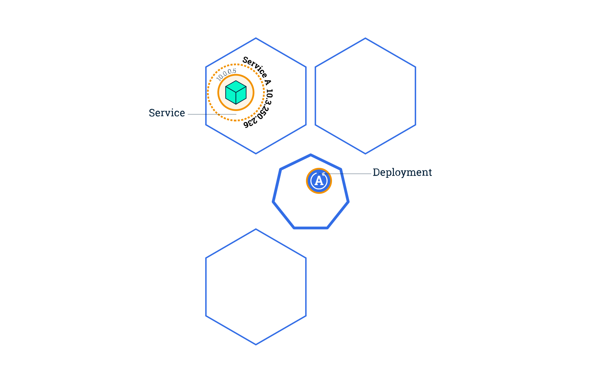

## Scaling an application 

assuming that a service with type: LoadBalancer is created for the kubernetes-bootcamp Deployment.



Scaling is accomplished by changing the number of replicas in a Deployment.

Scaling out a Deployment will ensure new Pods are created and scheduled to Nodes with available resources. Scaling will increase the number of Pods to the new desired state. Kubernetes also supports autoscaling of Pods, but it is outside of the scope of this tutorial. Scaling to zero is also possible, and it will terminate all Pods of the specified Deployment.

Running multiple instances of an application will require a way to distribute the traffic to all of them. Services have an integrated load-balancer that will distribute network traffic to all Pods of an exposed Deployment. Services will monitor continuously the running Pods using endpoints, to ensure the traffic is sent only to available Pods.

### Scaling a Deployment
To list your Deployments, use the get deployments subcommand:

```kubectl get deployments```

The output should be similar to:

```textmate
NAME                  READY   UP-TO-DATE   AVAILABLE   AGE
kubernetes-bootcamp   1/1     1            1           11m
```

We should have 1 Pod. If not, run the command again. This shows:
- NAME: lists the names of the Deployments in the cluster.
- READY: shows the ratio of CURRENT/DESIRED replicas
- UP-TO-DATE: displays the number of replicas that have been updated to achieve the desired state.
- AVAILABLE: displays how many replicas of the application are available to your users.
- AGE: displays the amount of time that the application has been running.

To see the ReplicaSet created by the Deployment, run:

```kubectl get rs```

Notice that the name of the ReplicaSet is always formatted as ```[DEPLOYMENT-NAME]-[RANDOM-STRING]```. The random string is randomly generated and uses the pod-template-hash as a seed.

Two important columns of this output are:

- DESIRED displays the desired number of replicas of the application, which you define when you create the Deployment. This is the desired state.
- CURRENT displays how many replicas are currently running.

Next, let’s scale the Deployment to 4 replicas. We’ll use the kubectl scale command, followed by the Deployment type, name and desired number of instances:

```kubectl scale deployments/kubernetes-bootcamp --replicas=4```

To list your Deployments once again, use get deployments:

```kubectl get deployments```

The change was applied, and we have 4 instances of the application available. Next, let’s check if the number of Pods changed:

```kubectl get pods -o wide```

There are 4 Pods now, with different IP addresses. The change was registered in the Deployment events log. To check that, use the describe subcommand:

```kubectl describe deployments/kubernetes-bootcamp```

You can also view in the output of this command that there are 4 replicas now.

### Load Balancing
Let's check that the Service is load-balancing the traffic. To find out the exposed IP and Port we can use describe service as we learned in the previous part of the tutorial:

```kubectl describe services/kubernetes-bootcamp```

Create an environment variable called NODE_PORT that has a value as the Node port:

```text
export NODE_PORT="$(kubectl get services/kubernetes-bootcamp -o go-template='{{(index .spec.ports 0).nodePort}}')"
echo NODE_PORT=$NODE_PORT
```

Next, we’ll do a curl to the exposed IP address and port. Execute the command multiple times:

```curl http://"$(minikube ip):$NODE_PORT"```

We hit a different Pod with every request. This demonstrates that the load-balancing is working.

The output should be similar to:
```text
Hello Kubernetes bootcamp! | Running on: kubernetes-bootcamp-644c5687f4-wp67j | v=1
Hello Kubernetes bootcamp! | Running on: kubernetes-bootcamp-644c5687f4-hs9dj | v=1
Hello Kubernetes bootcamp! | Running on: kubernetes-bootcamp-644c5687f4-4hjvf | v=1
Hello Kubernetes bootcamp! | Running on: kubernetes-bootcamp-644c5687f4-wp67j | v=1
Hello Kubernetes bootcamp! | Running on: kubernetes-bootcamp-644c5687f4-4hjvf | v=1
```

### Scale Down
To scale down the Deployment to 2 replicas, run again the scale subcommand:

```kubectl scale deployments/kubernetes-bootcamp --replicas=2```

List the Deployments to check if the change was applied with the get deployments subcommand:

```kubectl get deployments```

The number of replicas decreased to 2. List the number of Pods, with get pods:

```kubectl get pods -o wide```
This confirms that 2 Pods were terminated.