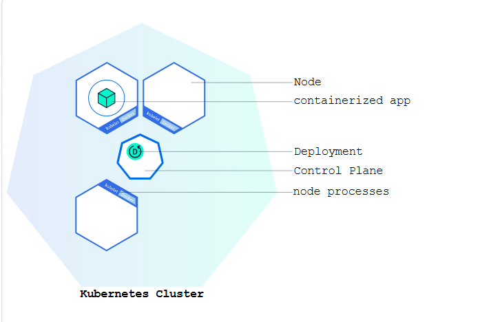

## Using kubectl to Create a Deployment

### Kubernetes Deployments
```text
A Deployment is responsible for creating and updating instances of your application.
```

* Deployment creation: You define a Kubernetes Deployment to specify how your application should run.
* Scheduling: The control plane assigns application instances (Pods) to Nodes in the cluster. 
* Monitoring & self-healing: The Deployment controller continuously checks the health of instances. If a Node fails, it automatically recreates the instance on another Node. 
* Advantage over scripts: Unlike traditional installation scripts, Deployments ensure resilience and recovery from machine failures, providing a robust orchestration mechanism.
```text
+-------------------+
| Create Deployment |
+-------------------+
          |
          v
+-------------------+
| Control Plane     |
| schedules Pods    |
+-------------------+
          |
          v
+-------------------+
| Pods run on Nodes |
+-------------------+
          |
          v
+-------------------------------+
| Deployment Controller monitors|
+-------------------------------+
          |
+-------------------+
| Node failure?     |
+-------------------+
         |
Yes ---> Replace Pod on another Node
No  ---> Keep running
```
### Deploying your first app on Kubernetes
Applications need to be packaged into one of the supported container formats in order to be deployed on Kubernetes.



#### kubectl basics
Syntax: 
```text
kubectl action resource.
```
This performs the specified action (like create, describe or delete) on the specified resource (like node or deployment.

#### Deploy an app
Let’s deploy our first app on Kubernetes with the kubectl create deployment command. We need to provide the deployment name and app image location (include the full repository url for images hosted outside Docker Hub).
```text
kubectl create deployment kubernetes-bootcamp --image=gcr.io/google-samples/kubernetes-bootcamp:v1
```
To list your deployments use the kubectl get deployments command:

```text
kubectl get deployments
```

