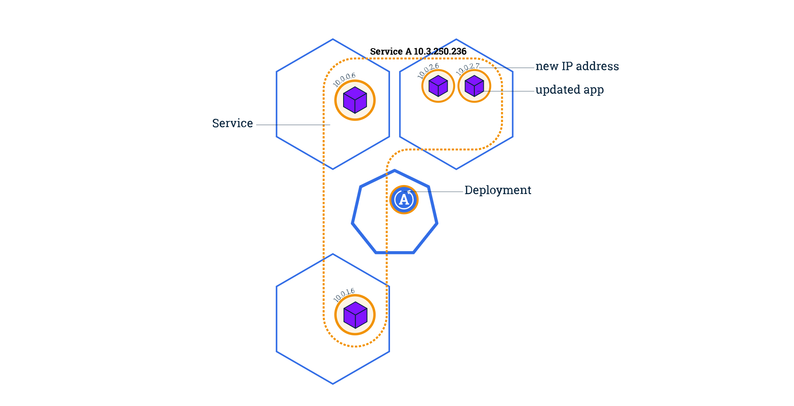

## Performing a Rolling Update

Rolling updates allow Deployments' update to take place with zero downtime by incrementally updating Pods instances with new ones.

Users expect applications to be available all the time, and developers are expected to deploy new versions of them several times a day. In Kubernetes this is done with rolling updates. A rolling update allows a Deployment update to take place with zero downtime. It does this by incrementally replacing the current Pods with new ones. The new Pods are scheduled on Nodes with available resources, and Kubernetes waits for those new Pods to start before removing the old Pods.

By default, the maximum number of Pods that can be unavailable during the update and the maximum number of new Pods that can be created, is one. Both options can be configured to either numbers or percentages (of Pods). In Kubernetes, updates are versioned and any Deployment update can be reverted to a previous (stable) version.



If a Deployment is publicly exposed, the Service will send traffic only to Pods that can handle requests.
This ensures users continue to access the application during an update.

During a rolling update, this behavior keeps the application available by routing traffic only to Pods that are serving requests. Rolling updates allow the following actions:

- Promote an application from one environment to another (via container image updates)
- Rollback to previous versions
- Continuous Integration and Continuous Delivery of applications with zero downtime

### Update the version of the app

To list your Deployments, run the get deployments subcommand:

```kubectl get deployments```

To list the running Pods, run the get pods subcommand:

```kubectl get pods```

To view the current image version of the app, run the describe pods subcommand and look for the Image field:

```kubectl describe pods```

To update the image of the application to version 2, use the set image subcommand, followed by the deployment name and the new image version:

```kubectl set image deployments/kubernetes-bootcamp kubernetes-bootcamp=docker.io/jocatalin/kubernetes-bootcamp:v2```

The command notified the Deployment to use a different image for your app and initiated a rolling update. Check the status of the new Pods, and view the old one terminating with the get pods subcommand:

```kubectl get pods```

### Verify an update

First, check that the service is running, run ```describe services/kubernetes-bootcamp```. If it's missing, you can create it again with:

```kubectl expose deployment/kubernetes-bootcamp --type="NodePort" --port 8080```

Create an environment variable called NODE_PORT that has the value of the Node port assigned:

```
export NODE_PORT="$(kubectl get services/kubernetes-bootcamp -o go-template='{{(index .spec.ports 0).nodePort}}')"
echo "NODE_PORT=$NODE_PORT"
```

Next, do a curl to the exposed IP and port:

```curl http://"$(minikube ip):$NODE_PORT"```

Every time you run the curl command, you will hit a different Pod. Notice that all Pods are now running the latest version (v2).

You can also confirm the update by running the rollout status subcommand:

```kubectl rollout status deployments/kubernetes-bootcamp```

To view the current image version of the app, run the describe pods subcommand:

```kubectl describe pods```

In the Image field of the output, verify that you are running the latest image version (v2).

### Roll back an update

Let’s perform another update, and try to deploy an image tagged with v10:

```commandline
kubectl set image deployments/kubernetes-bootcamp kubernetes-bootcamp=gcr.io/google-samples/kubernetes-bootcamp:v10
```
Use get deployments to see the status of the deployment:

```kubectl get deployments```

Notice that the output doesn't list the desired number of available Pods. Run the get pods subcommand to list all Pods:

```kubectl get pods```

Notice that some of the Pods have a status of ImagePullBackOff.

To get more insight into the problem, run the describe pods subcommand:

```kubectl describe pods```

In the Events section of the output for the affected Pods, notice that the v10 image version did not exist in the repository.

To roll back the deployment to your last working version, use the rollout undo subcommand:

```kubectl rollout undo deployments/kubernetes-bootcamp```

The rollout undo command reverts the deployment to the previous known state (v2 of the image). Updates are versioned and you can revert to any previously known state of a Deployment.

Use the get and discribe pods subcommand to check Pods again:

```kubectl get pods```

```kubectl describe pods```

Remember to clean up your local cluster.

```kubectl delete deployments/kubernetes-bootcamp services/kubernetes-bootcamp```